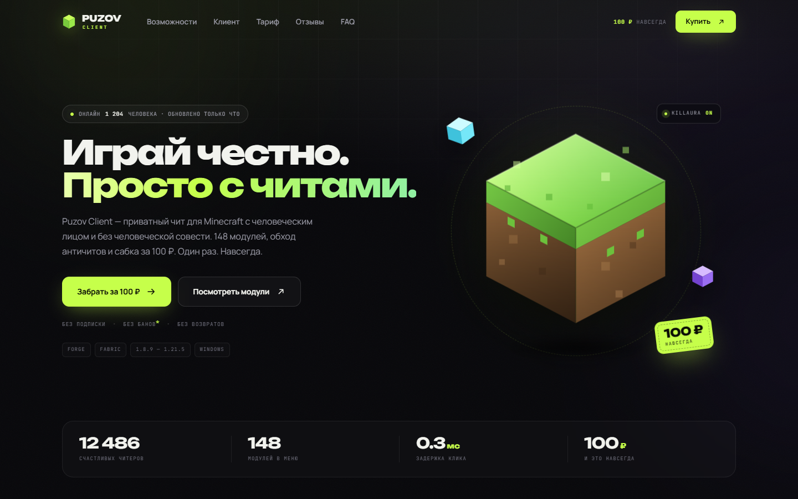
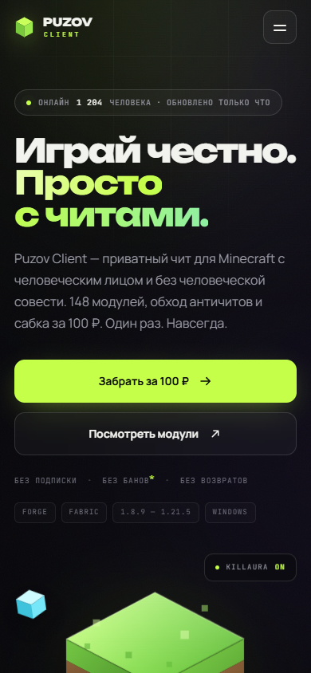

# PUZOV CLIENT

Шуточный лендинг «приватного чита для Minecraft» за 100 ₽ навсегда.
Друг поставил себе в ник `puzov-client.ru`, домен купили, сайт сделали. Вот и всё.

**Это не чит, не магазин и не приглашение что-то устанавливать.** Оплата демонстрационная,
ключ ненастоящий, лоадера не существует. Сайт существует ради рофла.

## Превью





## Что внутри

- Тёмный лендинг с неоновым лаймовым акцентом, изометрическим блоком и стеклянными чипами.
- Интерактивное окно клиента: 5 категорий, 30 модулей, поиск, тумблеры и слайдеры.
- Блок тарифа «100 ₽ навсегда», отзывы, FAQ-аккордеон.
- Демо-оплата с «ключом» `PUZOV-100RUB-NAVSEGDA`, тосты, конфетти.
- Адаптив от 320 px, поддержка `prefers-reduced-motion`, доступные тумблеры и аккордеон.
- Пасхалка: код Konami (↑ ↑ ↓ ↓ ← → ← → B A) включает GODMODE.

## Стек

Чистый HTML + CSS + JavaScript. Без сборки, без зависимостей, без бэкенда.

```
index.html
assets/
  css/style.css
  js/main.js
  favicon.svg
  og.png
preview/
  desktop.png
  mobile.png
CNAME
robots.txt
sitemap.xml
```

## Локальный запуск

Просто открой `index.html` в браузере. Шрифты подтягиваются с Google Fonts, поэтому
для полного вида нужен интернет.

Если хочется как на хостинге:

```bash
npx serve .
# или
python -m http.server 8000
```

## Деплой

Сайт статический — собирать нечего.

- **GitHub Pages:** залей репозиторий, в Settings → Pages выбери ветку и папку `/ (root)`.
  Файл `CNAME` уже содержит `puzov-client.ru`; в DNS домена настрой A-записи на
  `185.199.108.153`, `185.199.109.153`, `185.199.110.153`, `185.199.111.153`
  (или CNAME `www` → `<username>.github.io`). HTTPS включается галочкой.
- **Netlify / Cloudflare Pages / Vercel:** закинь папку целиком, build command оставь пустым,
  publish directory — корень.
- **Обычный хостинг:** залей содержимое папки в `public_html`.

## Что менять

| Что | Где |
| --- | --- |
| Цена и текст тарифа | `index.html`, секция `#pricing` |
| Модули клиента | `assets/js/main.js`, объект `MODULES` |
| Отзывы и FAQ | `index.html` |
| Ключ после «оплаты» | `index.html` (`#licenseKey`) и `main.js` |
| Тексты тостов | атрибуты `data-toast` в `index.html` |
| Превью для соцсетей | `assets/og.png` + meta-теги в `<head>` |

## Важно

- Мы не продаём читы и не призываем их использовать. Читы нарушают правила серверов
  и портят игру другим — этот сайт только шутит.
- Не подключай сюда реальную оплату: продажа читов — плохая идея и нарушение правил
  платёжных систем.
- Minecraft — товарный знак Mojang Studios. Проект с Mojang никак не связан.
- Все цены, отзывы, баны и «12 486 счастливых читеров» выдуманы.

Сделано на рофле. Приятной игры.
